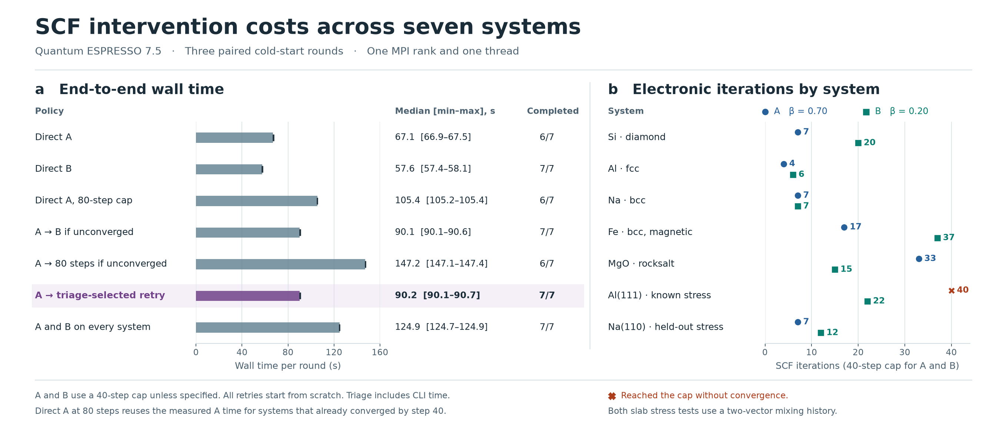

# Does SCF triage save compute time?

For these seven inputs, terminal triage completed the same seven jobs and used the same solver calls as reducing β once after any electronic nonconvergence. Each seven-job batch paid an extra **0.055 s** (median) for classification and confirmation. All five previously untested inputs converged on their first run at β=0.70. The only mixing retry was for the Al(111) slab already used to develop the rule.

Two separate, intentionally broken inputs produced a different result. Identifying the missing Fe pseudopotential and the two-step Si budget avoided one wasted β retry each. The median saving across the pair was **1.81 s**, including diagnosis. Correctly interpreting those errors by hand leads to the same solver calls.

## Seven-job batch cost

Each round contains one cold start per material setting for each measured arm. The table replays policies on the same recorded runs. Seconds include process startup, all failed attempts and the triage CLI where applicable. Simple baselines receive the completion state for free. A task counts as complete only with QE electronic convergence, the completion footer, a finite final energy and normal exit.

| Policy | Complete each round | Solver calls per round | Round 1, s | Round 2, s | Round 3, s | Median, s |
| --- | ---: | ---: | ---: | ---: | ---: | ---: |
| β=0.70, cap 40 | 6/7 | 7 | 67.50 | 66.87 | 67.07 | 67.07 |
| β=0.20, cap 40 | 7/7 | 7 | 57.36 | 58.06 | 57.64 | 57.64 |
| β=0.70, cap 80 from the start* | 6/7 | 7 | 105.15 | 105.44 | 105.41 | 105.41 |
| At failure, retry once at β=0.20 | 7/7 | 8 | 90.62 | 90.11 | 90.06 | 90.11 |
| Triage existing logs, then follow the decision | 7/7 | 8 | 90.67 | 90.16 | 90.11 | 90.16 |
| At failure, retry once with cap 80 | 6/7 | 8 | 147.11 | 147.24 | 147.37 | 147.24 |
| Run both 40-step settings for every case† | 7/7 | 14 | 124.86 | 124.93 | 124.71 | 124.86 |

\* For the six cases that converged within 40 steps, the direct 80-step policy reuses the successful A timing. Only Al(111) was rerun with its cap increased. Every retry starts from scratch. State-preserving continuation was outside this experiment.

† Supplementary accounting after the protocol was frozen. Both settings run to convergence or the cap and any successful output can be kept. Even with this reuse, paying for both cost 34.60 s more per batch than triage (median of paired differences). Short pilot runs and the economics of reusing a tuned value across a family of related structures were outside this comparison.

## Dependence on β

Each entry gives outcome, electronic iterations and median process wall time over three cold starts. ✓ means accepted in all three and ✗ means unaccepted in all three. The two slabs use a mixing history of two vectors. The bulk inputs use eight. All target the same SCF threshold of 1e−8 Ry.

| Setting | β=0.70, cap 40 | β=0.20, cap 40 | β=0.70, cap 80 |
| --- | ---: | ---: | ---: |
| Diamond Si (known control) | ✓ 7 / 2.01 s | ✓ 20 / 3.38 s | — |
| fcc Al | ✓ 4 / 1.54 s | ✓ 6 / 1.72 s | — |
| bcc Na | ✓ 7 / 2.51 s | ✓ 7 / 2.40 s | — |
| Ferromagnetic bcc Fe | ✓ 17 / 5.53 s | ✓ 37 / 10.76 s | — |
| Rocksalt MgO | ✓ 33 / 3.37 s | ✓ 15 / 2.12 s | — |
| Three-layer Na(110) | ✓ 7 / 10.16 s | ✓ 12 / 14.17 s | — |
| Six-layer Al(111) (known stress control) | ✗ 40 / 41.96 s | ✓ 22 / 23.11 s | ✗ 80 / 80.31 s |

Lower β sped up MgO and slowed down Fe. Triage accepted both of their converged β=0.70 runs. In the short-history Al slab, β=0.70 exhausted the 80-step budget in every round, while β=0.20 converged in 22 steps. In a previous eight-vector control for the same Al slab, β=0.70 converged in 18 steps and β=0.20 in 27. QE's documented defaults are β=0.70, eight mixing vectors and a 100-step cap. The 40-step cap and two-vector stress setting here were explicit experimental choices. [Eight-vector control](../../examples/al111/README.md) · [QE input reference](https://www.quantum-espresso.org/Doc/INPUT_PW.html)

Across same-round successful settings for the same input, the maximum spread in printed total energy was 4e-08 Ry. Ferromagnetic Fe gave the same total moment to QE's printed precision (difference 0 μB/cell). This checks agreement of electronic solutions at these inputs. Production values for surface energy, magnetic order, or other observables require their own convergence tests.

## What the diagnoses caught

- **A successful exit without SCF convergence.** The first Al(111) A run returned zero and printed `JOB DONE.` at line 595. Line 544 of `measured/al111-stress/r1/A/pw.out` records electronic nonconvergence. Triage cites the terminal status and late accuracy rebounds and suggests testing one mixing change. Reading progressively longer prefixes, the first nonbinding rebound review appeared at iteration 13. All three failed A runs raised this review and none of the 18 converged A runs did. The lower-β Si and Fe runs also triggered this review (first at steps 16 and 15) but went on to converge. Killing an A/B run on its first alert would have interrupted six of 39 successful runs. No job was killed early during the experiment.
- **Two injected faults.** For Si the diagnosed action was to restore a usable iteration budget. For Fe it was to correct the missing UPF path. Changing only β left both faults in place in all three rounds. Failure, targeted repair and CLI confirmation cost 9.46 s per pair. Adding one blind β retry before the same repair cost 11.25 s (medians). A baseline that already handles file errors or short budgets avoids those extra calls too. The corrected run in each scenario reuses the corresponding normal A measurement from that round. These controls demonstrate consequences of a wrong retry decision. Their prevalence in production is unknown.
- **Operator cost.** The median single-log CLI call, including process launch and JSON output, took 24.5 ms. Human reading time, queue delays and parallel job billing were outside the measurement. No service-level speedup can be inferred from these numbers.

## Scope and evidence

The frozen protocol covered seven input configurations across five chemical systems on one Apple M5 with PWSCF 7.5, one rank and one thread. Si and the difficult Al(111) configuration were known controls. Each retained its first-run decision pattern across the three repetitions. These repetitions characterize local timing repeatability. Five previously untested settings supplied zero new natural intervention cases. The results support using the tool to identify failed jobs and explain a next action. A general solver-time advantage over a simple failure rule remains unproven.

The validation itself paid for **57 QE processes and 626.02 s (10.43 min)** of solver wall time, counting all input arms and fault injections once. The separate CLI latency experiment measured 336 short-lived invocations totaling 8.39 s. Each policy's table entry charges only the CLI calls relevant to that policy.

[Download all inputs, stdout, timings, checksums and replay scripts](scf-cost-panel.zip) · [Run and verify the experiment](REPRODUCE.md) · [Frozen protocol](protocol.md) · [Machine-readable policy ledger](results/panel-summary.json) · [Full experiment costs](results/cost-details.json)
