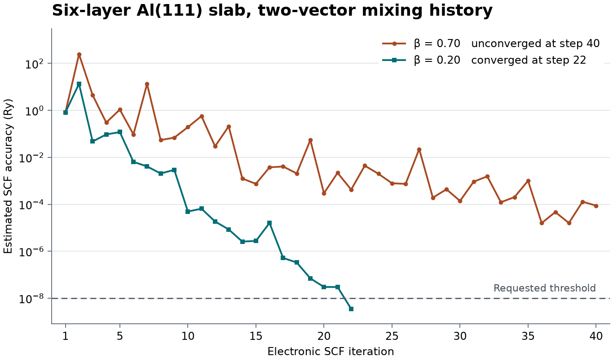

# When to intervene in an Al(111) slab calculation

The two saved logs show a case where changing one parameter resolves an electronic convergence failure. The six-atom Al(111) slab uses plain mixing with a two-vector history (`mixing_ndim=2`). At β=0.70 the SCF accuracy estimate repeatedly worsens and the job exhausts 40 iterations. A fresh run at β=0.20 reaches the same requested threshold in 22. **With QE's default eight-vector history, both values converge and β=0.70 finishes first.**

## Triage the saved logs

Run these commands from the repository root.

~~~sh
scf-slim triage examples/al111
scf-slim diagnose examples/al111/beta-070.out
~~~

In the [β=0.70 stdout](beta-070.out), lines 518 and 529 show the printed estimate rebounding from `< 1.599e-5 Ry` at step 38 to `< 1.2910e-4 Ry` at step 39. Line 544 declares electronic nonconvergence. The completion footer follows at line 595. This history supports testing a smaller mixing factor while holding other inputs fixed. In the [β=0.20 stdout](beta-020.out), line 393 reports `< 3.5e-9 Ry` and line 404 confirms convergence. The low residual alone would not establish why the original run failed.

Regenerate the figure with `python3 examples/al111/plot_accuracy.py` from a checkout with Matplotlib installed.

## Paired measurements

The criterion, set before running either input, required exactly one arm to reach `conv_thr=1e-8 Ry` within `electron_maxstep=40`. The first tested slab met that criterion. We repeated the pair in reverse order, then changed only the mixing-history length for a separate control.

| Mixing history | β | QE verdict | Iterations | Last printed estimate (Ry) | End-to-end wall time (s) |
| ---: | ---: | --- | ---: | ---: | ---: |
| 2 | 0.70 | Unconverged | 40 in both runs | < 8.758e-5 | 41.91, 41.61 |
| 2 | 0.20 | Converged | 22 in both runs | < 3.5e-9 | 22.99, 22.94 |
| 8 | 0.70 | Converged | 18 | < 5.3e-9 | 20.01 |
| 8 | 0.20 | Converged | 27 | < 5.1e-10 | 27.73 |

For the first short-history pair, discovering the failure and then completing the retry cost **64.90 s**. In the eight-vector control the original β already converged in 20.01 s. No preliminary sweep is needed to use these logs. The measurements establish sensitivity for this geometry, mixing scheme and finite budget. Further iterations might also have allowed the failed arm to converge.

Both inputs use six unrelaxed fcc(111) Al layers at a bulk lattice parameter of 4.05 Å, an 18 Å vacuum gap, a 4×4×1 mesh, PBE PAW, 40/320 Ry cutoffs and Marzari–Vanderbilt smearing of 0.02 Ry. The short history was chosen to stress mixing, as in the project's [Al slab template](../../scripts/scf_slim/configs/templates/Al_111_slab_scf.in). This example tests electronic convergence; surface energies require their own thickness, vacuum, k-point and cutoff studies. QE documents how the mixing factor and history enter the SCF method. [PWscf input reference](https://www.quantum-espresso.org/Doc/INPUT_PW.html) · [SCF troubleshooting](https://www.quantum-espresso.org/Doc/pw_user_guide/node21.html)

Each run started from atomic potential and wavefunctions in an empty scratch directory. PWSCF 7.5 ran serially with one MPI rank and one BLAS/OpenMP thread on an Apple M5. Times include QE-JLL launcher startup. The two loose stdout files contain the complete first-pair output. The [validation archive](validation-logs.zip) holds the four additional input/output pairs. Filenames identify β, history length and replicate. The eight-vector control has one run per β. The [measurement record](measurements.json) gives the order, archive member names, SHA-256 hashes, final marked energies where available and elapsed times for all six runs.

## Reproduce with pw.x

From the repository root, download the same Al PBE PAW potential and run the pair. The script checks the [official pseudopotential](https://pseudopotentials.quantum-espresso.org/legacy_tables/ps-library/al) against the recorded SHA-256 before starting. Set `--pw` if the binary is outside your PATH.

~~~sh
pseudo=Al.pbe-n-kjpaw_psl.1.0.0.UPF
curl -fL "https://pseudopotentials.quantum-espresso.org/upf_files/$pseudo" -o "$pseudo"
python3 examples/al111/reproduce.py --pseudo "$pseudo" --outdir al111-results
scf-slim triage al111-results
~~~

Use `--all-runs` on a fresh output directory to run the reverse-order repeat and the eight-vector control as well. The script checks the short-history contrast and, when requested, convergence of both eight-vector arms. Exit code 0 means the requested electronic outcomes were reproduced, 1 means a completed comparison produced a different outcome, and 2 means an input, launcher or output problem prevented a comparison. Exact iteration counts, elapsed times and the speed ranking of the control are descriptive measurements and may vary across builds.
